# Architecture

gtwy-ai (this repo) is the **execution service** of GTWY: a FastAPI app that takes a completion request for an agent, loads that agent's configuration, calls the LLM provider with tools, and returns the answer. Its sibling **gtwy-node** (Node/Express, repo `AI-middleware`) is the control plane. gtwy-node owns agent CRUD, the Mongo schemas, Lago wallet writes and cache invalidation, and it consumes this service's queues to write history and metrics.

This repo has no database migrations and no tests. It reads Mongo, uses Redis heavily, publishes to RabbitMQ and reads Postgres only for history on a cache miss.

## Entry point and startup

- `index.py:app` is served by gunicorn with 2 uvicorn workers on port 8080 (see the `Dockerfile`).
- `index.py:lifespan` loads the model, service and billing-plan registries from Mongo; connects RabbitMQ; starts the consumer and batch poller on consumer pods (`CONSUMER_STATUS`); and starts change-stream listeners and other loops.
- SIGTERM flips `globals.is_ready` so `/ready` returns 503 and the pod drains.

Full sequence: [flows/startup-and-background-jobs.md](flows/startup-and-background-jobs.md).

Routers are mounted in `index.py`: `/api/v2/model` (chat, ai/completion, openai/responses, batch, testcases, rerun), `/browser`, `/chatbot`, `/image/processing` and `/files` (the same router twice), and `/rag`. Every route is listed in [api.md](api.md).

## Layers

| Layer | Folder | Owns | May call |
|---|---|---|---|
| Routes | `src/routes/` | Path, Pydantic schema (`src/schemas/`), dependency chain | middlewares, controllers, `common.py` |
| Middlewares | `src/middlewares/` | Auth (JWT, proxy token, pauthkey, chatbot), Redis rate limits, **agent config assembly and the credit hold** | db_services, `getConfiguration`, billing |
| Controllers | `src/controllers/` | Thin glue for conversation, image, RAG, testcases | services |
| Orchestration | `src/services/commonServices/common.py`, `src/services/utils/common_utils.py` | One completion: agent choice, pre-tools, history, fallback, streaming, transfer, reviewer, post-tool, publishing | providers, tool loop, billing, queues |
| Provider + tool loop | `src/services/commonServices/baseService/`, one folder per provider | Provider request shape, dispatch, recursive tool calls | external APIs, `chat()` (agent-as-tool) |
| Formatting and cost | `src/services/utils/formatters/`, `src/services/utils/token_calculation.py` | One response shape, usage, cost | none |
| Data access | `src/db_services/`, `src/services/cache_service.py`, `models/` | Mongo, Postgres and Timescale queries; Redis helpers | drivers |
| Config and registries | `config.py`, `src/configs/` | Env vars (`Config`), `redis_keys`, `service_name`, in-memory registries fed by Mongo change streams | Mongo |

Dependencies point down the table. The one deliberate cycle is agent-as-tool: the tool loop calls `src/services/commonServices/common.py:chat` in-process for a connected agent. Several imports are deliberately lazy to break import cycles; [conventions.md](conventions.md#imports-and-cycles) lists them.

## How a request moves

```mermaid
flowchart LR
  C[Client] --> R[modelRouter chat/completion]
  R --> M[auth + rate limit]
  M --> CFG[add_configuration_data_to_body<br/>config + credit hold]
  CFG --> Q{queued?}
  Q -- webhook / RTLayer --> MQ[(main queue)] --> CON[consumer pod]
  Q -- sync / stream --> CMA[chat_multiple_agents]
  CON --> CMA
  CMA --> CH[chat]
  CH --> P[provider handler + tool loop]
  P --> T[tail: fallback, reviewer, post-tool, cost]
  T --> BG[process_background_tasks]
  BG --> LQ[(log + metrics queues)] --> NODE[gtwy-node writes Postgres/Timescale]
  T --> RESP[HTTP / SSE / webhook / RTLayer]
```

1. `src/routes/v2/modelRouter.py:chat_completion`. Dependencies authenticate and rate-limit, then `src/middlewares/getDataUsingBridgeId.py:add_configuration_data_to_body` builds `bridge_configurations` and reserves credits ([agent-configuration.md](modules/agent-configuration.md), [billing-and-limits.md](modules/billing-and-limits.md)).
2. The route either publishes to the main queue (webhook or RTLayer delivery, and non-stream playground calls) or runs `chat_multiple_agents` inline.
3. `src/services/commonServices/common.py:chat` runs the completion ([chat-orchestration.md](modules/chat-orchestration.md)). The provider handler and the tool loop are in [llm-providers.md](modules/llm-providers.md) and [tool-calling.md](modules/tool-calling.md).
4. `src/services/utils/common_utils.py:process_background_tasks` publishes history and metrics, and the reply is sent after that ([queues-history-metrics.md](modules/queues-history-metrics.md)).

Every hop, branch and data shape: [flows/chat-completion.md](flows/chat-completion.md).

## Optional subsystems per request

| Subsystem | Turned on by | Doc |
|---|---|---|
| Plan ("todo") mode | request body `mode: "plan"` | [todo-mode.md](modules/todo-mode.md) |
| Reviewer loop | agent `settings.review_agent.*` | [reviewer-and-guardrails.md](modules/reviewer-and-guardrails.md) |
| Gtwy_Browser tool | agent built-in tools | [gtwy-browser.md](modules/gtwy-browser.md) |
| Batch | `POST /api/v2/model/batch/chat/completion` | [batch-api.md](modules/batch-api.md) |
| Test cases / rerun | `/testcases`, `/rerun` routes | [testcases.md](modules/testcases.md) |
| Files, RAG, chatbot | their own routers | [media-rag-chatbot.md](modules/media-rag-chatbot.md) |

## External systems

| System | Used for | Client code |
|---|---|---|
| MongoDB | Agents, versions, API keys, services, models, plans, folders, cookies | `models/mongo_connection.py`, `src/db_services/` |
| Redis | Agent config cache, rate limits, conversation cache, credit holds, spend limits, plans, batch state, browser registry | `src/services/cache_service.py` |
| RabbitMQ | Main request queue (consumed here), log and metrics queues (consumed by gtwy-node) | `src/services/commonServices/queueService/` |
| Postgres / Timescale | History read on a conversation-cache miss; written by gtwy-node | `models/postgres/`, `models/Timescale/` |
| LLM providers | OpenAI, Anthropic, Gemini, Groq, Grok, Mistral, DeepSeek, Deepgram, TypeSafe and any OpenAI-compatible service in the `services` collection | [llm-providers.md](modules/llm-providers.md) |
| Lago (read-only) | Wallet balance and plan lookup | `src/services/billing/lago_service.py` |
| MSG91 proxy | Resolving proxy tokens and pauthkeys to user and org | `src/services/proxy/Proxyservice.py` |
| RTLayer | Playground delivery, history pushes, status events | `src/services/commonServices/baseService/utils.py:send_message` |
| viaSocket flows | Customer HTTP tools, pre and post tools, GPT memory, internal alerts | `src/services/commonServices/baseService/utils.py:axios_work` |
| Hippocampus | Semantic response cache and RAG search | `src/services/commonServices/response_caching_service.py` |
| Firecrawl, Steel, NotDiamond, GCP storage | Web search, browser tool, auto model routing, file uploads | module docs |

## Cross-repo contracts

> [!WARNING]
> gtwy-node and this repo share Mongo, Redis, RabbitMQ and money. Changing any of the following on one side only breaks the other side silently.

- **Mongo schemas are owned by gtwy-node** (its src/mongoModel folder). This repo only reads them, plus writes a few of its own documents. Details: [data-model.md](data-model.md).
- **Redis:**
  - Every key carries the `AIMIDDLEWARE_<ENV>_` prefix.
  - `cd_` keys can be deleted (rebuildable); `nd_` keys must survive a bulk clear.
  - Cache tags in `tag_keys` (`src/configs/constant.py`) must match gtwy-node's tagKeys.js, because gtwy-node purges agent caches by tag.
  - Details: [queues-history-metrics.md](modules/queues-history-metrics.md).
- **Queues:**
  - Queue names (`QUEUE_NAME`, `LOG_QUEUE_NAME`, `METRICS_QUEUE_NAME`) must match in both repos.
  - Every field added to a history message must also be mapped in gtwy-node's history consumer, or it is dropped.
- **History shape:** gtwy-node's analytics query `tools_call_data` keys directly in Postgres ([tool-calling.md](modules/tool-calling.md)).
- **Billing:** commission, credit rate, plan codes, the hit-fee transaction id format and the shadow balance keys must match ([billing-and-limits.md](modules/billing-and-limits.md#cross-repo-contracts)).
