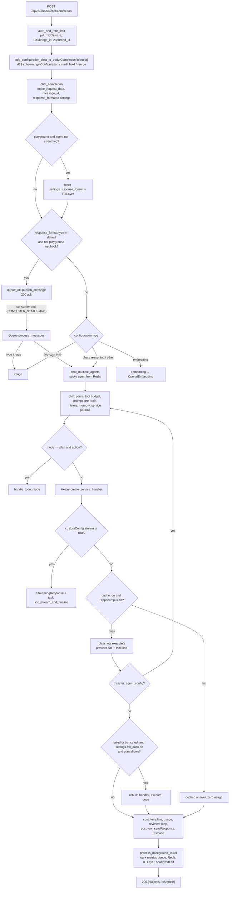

# Flow: chat completion

`POST /api/v2/model/chat/completion` takes a user message plus an agent id. It answers in one of three ways: a JSON completion, an SSE stream, or an acknowledgement. With an acknowledgement, the answer goes later to a webhook or RTLayer channel through the RabbitMQ main queue. Either way it publishes history, metrics and billing to the log and metrics queues for gtwy-node to save.

This page follows one request across modules. How each module works inside is in [agent-configuration](../modules/agent-configuration.md), [chat-orchestration](../modules/chat-orchestration.md), [tool-calling](../modules/tool-calling.md) and [llm-providers](../modules/llm-providers.md).



## Steps

1. **Mount and auth.** `index.py` mounts the router at `/api/v2/model`. `src/routes/v2/modelRouter.py:auth_and_rate_limit` runs `src/middlewares/middleware.py:jwt_middleware` (JWT, `proxy_auth_token` or `pauthkey`; sets `request.state.profile`). A JWT with a top-level `folder_id` is a gtwy embed token: `src/services/proxy/embed_service.py:resolve_gtwy_embed_token` verifies it with the org's own `gtwyAccessToken` instead of `Config.SecretKey`, and finds or creates the embed user through MSG91. Then `src/middlewares/ratelimitMiddleware.py:rate_limit` allows 100 hits per `body.bridge_id` and 20 per `body.thread_id` per 60 s. Details: [auth paths](../modules/agent-configuration.md#auth-paths), [rate limits](../modules/agent-configuration.md#rate-limits).
2. **Build the configuration.** `src/middlewares/getDataUsingBridgeId.py:add_configuration_data_to_body` is a FastAPI dependency built with `CompletionRequest`. In order:
   1. Validate the body (422 on failure).
   2. `src/services/utils/getConfiguration.py:getConfiguration` builds `bridge_configurations`: the primary agent plus its connected and reviewer agents. Connected agents, pre-tools, the post-tool, RAG docs and built-in tools are read from the agent's `connected_tools` list. The legacy `connected_agents`, `pre_tools` and `post_tool` fields are still read, but the agent-level `doc_ids` and `built_in_tools` are not ([building the configuration](../modules/agent-configuration.md)).
   3. `src/services/billing/billing_utils.py:reserve_credits_and_api_key_setup` fills platform keys and sets `wallet` on each config. It places a credit hold only for chat-type requests that need the wallet or whose org plan charges a fee on every hit.
   4. The primary config is merged into the body: `body.update(primary_config)`. The request's `wrapper_id` and `settings.response_format` are put back afterwards.
   5. Last checks: a user message is required, and the model must exist in `model_config_document`.

   The merged body stays in the cached `request.json()`, so later code reads it from there. Details: [building the configuration](../modules/agent-configuration.md).
3. **Shape the request.** `src/routes/v2/modelRouter.py:chat_completion` sets `request.state.version = 2` and calls `src/services/commonServices/baseService/utils.py:make_request_data`. It stamps a new `message_id` (uuid1) and moves `configuration.response_format` to `settings.response_format`.
4. **Playground rewrite.** If `is_playground` is set and the agent's `configuration.stream` is `False`, `None` or `"default"`, `settings.response_format` is replaced with RTLayer on channel `{org_id}_{bridge_id}[_{version_id}]_{user_id}`. So the request goes to step 5's queue branch.
5. **Queue or run now.** If `settings.response_format.type` is anything except `default`, and the request is not a playground webhook:
   - The route stamps `body.created_at`, calls `queue_obj.publish_message(data_to_send)` and returns the acknowledgement at once. The rest of this list then runs on a consumer pod (step 15).
   - If the publish fails, the route releases the hold and returns 500.
6. **Pick the handler by type** (sync only). `configuration.type`:
   - `embedding` → `src/services/commonServices/common.py:embedding` (OpenAI only, returns formatted embedding, no history, no hold)
   - `image` → `src/services/commonServices/common.py:image`
   - anything else → `src/services/commonServices/common.py:chat_multiple_agents`
7. **Pick the agent.** `chat_multiple_agents` reads Redis `cd_last_transffered_agent_{primary}_{thread}_{sub}`. If this thread was transferred before, that agent becomes primary. It merges that agent's config over the body, keeps `wrapper_id` and `settings.response_format`, sets `primary_bridge_id`, and calls `chat` ([agent transfer](../modules/chat-orchestration.md#agent-transfer)).
8. **Prepare the call.** `src/services/commonServices/common.py:chat` builds `parsed_data` with `src/services/utils/common_utils.py:parse_request_body` and pops `credit_hold_token`, so this frame owns the release. It then runs the steps below, all in `common_utils.py` except where a file is named. The full list is in [the pipeline](../modules/chat-orchestration.md#3-the-pipeline-chat).
   - MCP prefetch, reviewer settings, and `init_tool_count` (the tool budget, `maximum_iterations`, default 3).
   - `setup_agent_tools`, `apply_prompt_wrapper`, `add_default_template`.
   - Auto model select (optional).
   - `load_model_configuration`, then `handle_pre_tools` and `manage_threads` (history: Redis, then Postgres).
   - `prepare_prompt` (variables, GPT memory), `configure_custom_settings`, `build_service_params`, `normalize_response_type`.
9. **Plan mode.** If `parsed_data.mode == "plan"`:
   - With an `action`, `chat` returns `src/services/todo/todo_handler.py:handle_todo_mode`.
   - Without one, `src/services/todo/planner_service.py:prepare_planner_request` injects the planner prompt and the call continues.
10. **Build the handler.** `src/services/utils/helper.py:Helper.create_service_handler` picks the provider class ([llm-providers](../modules/llm-providers.md)). `BaseService.__init__` sets `stream_mode` only when `customConfig.stream is True`.
11. **Stream branch.** If `stream_mode` is set, `chat` starts `src/services/utils/common_utils.py:sse_stream_and_finalize` as an asyncio task. It hands the tool-budget cleanup to `cleanup_tool_count_after` and the hold release to `release_credits_after`. Then it returns `StreamingResponse(streamer.generator())` at once ([streaming](../modules/chat-orchestration.md#streaming-sse)). A transfer that inherits the caller's stream (`_injected_streamer`) returns `{"success": true}` instead, and the caller's stream carries the output.
12. **Execute.** `src/services/commonServices/response_caching_service.py:handle_response_caching`:
    - If `cache_on`, type `chat` and a user message are all set, it searches Hippocampus (score ≥ 0.85). A hit returns the stored answer.
    - Otherwise it calls `class_obj.execute()`: the provider call and the tool loop ([the tool loop](../modules/tool-calling.md#the-tool-loop)).
    - A `json_object` / `json_schema` reply that does not parse is repaired with `repair_json`.
13. **Transfer and fallback.**
    - If `result.transfer_agent_config.action_type == "transfer"`, the current history row goes to `TRANSFER_HISTORY` and `handle_agent_transfer` calls `chat` again for the target agent. Its response is returned as is.
    - If the call raised or returned `success: False`, and `settings.fall_back.is_enable` is on, and `fallback_allowed_on_plan` allows it: `apply_wallet_fallback` runs, the model config and handler are rebuilt, and `execute()` runs once more. The non-stream retry calls plain `execute()`, so it skips the response cache ([fallback](../modules/chat-orchestration.md#fallback)).
    - A successful answer with `finish_reason == "truncated"` (cut off by a token limit) gets the same retry under the same conditions. The primary call's cost is computed first and, for a wallet run, kept in `_wallet_primary_cost` so it is still billed. If the retry raises, `chat` puts back the primary result, model and key and returns the cut-off answer instead of an error.
    - If it still failed, `chat` raises `ValueError(result)`.
14. **Tail, in this order.**
    1. `message_id`, and `finish_reason = "maximum_iteration_limit_reached"` if the tool budget ran out.
    2. Cost (`calculate_total_cost`).
    3. `render_template_if_applicable`.
    4. `update_usage_metrics`.
    5. `src/services/commonServices/reviewer_service.py:run_review_loop` (if a reviewer is set).
    6. `handle_post_tool`, which may replace the content.
    7. `sendResponse` to the webhook or RTLayer (it does nothing for `default`).
    8. Testcase scoring, when `testcase_data.run_testcase` is set.
    9. `process_background_tasks`.
    10. The sticky-agent key is written for 3 days.

    Then it returns `JSONResponse(200, {"success": true, "response": …})`. The `finally` block cleans the tool budget, starts the cost, last-used and API-key-status tasks, and releases the hold.
15. **Queued requests.** `src/services/commonServices/queueService/queueService.py:Queue.process_messages` runs on pods started with `CONSUMER_STATUS=true` (see `index.py`). It calls `image` for `configuration.type == "image"` and `chat_multiple_agents` for everything else, with the same `data_to_send`. The return value is thrown away. The answer reaches the client only through `sendResponse`.

## Branches

| Condition | Where decided | What the caller gets |
|---|---|---|
| `settings.response_format.type` is `webhook` / `RTLayer`, and not (`webhook` + `is_playground`) | `chat_completion` | 200 `{"success": true, "message_id", "message": "Your response will be sent through configured means."}`. The result is posted later by the consumer. |
| `is_playground` and the agent's `configuration.stream` is `False` / `None` / `"default"` | `chat_completion` | Same acknowledgement; the result goes to RTLayer `{org_id}_{bridge_id}[_{version_id}]_{user_id}` |
| Playground + webhook | `chat_completion` | Runs in the request (sync) and also posts to the webhook |
| `configuration.type == "embedding"` | `chat_completion` | 200 `{"success": true, "response": {"data": {"embedding": [...]}}}` |
| `configuration.type == "image"` | `chat_completion`, `Queue.process_messages` | 200 `{"success": true, "response": {"data": {"image_urls": [...]}, "usage": {...}}}` |
| `customConfig.stream is True` | `BaseService.__init__`, `chat` | `text/event-stream` (events listed in [contracts](../modules/chat-orchestration.md#contracts)) |
| Sticky agent cached for the thread | `chat_multiple_agents` | Same shapes, answered by the last agent that handled the thread |
| `mode == "plan"` with `action` | `chat` | Whatever `handle_todo_mode` returns ([todo-mode](../modules/todo-mode.md)) |
| Response cache hit | `handle_response_caching` | Normal 200 shape, zero usage. History row marked `is_cached`. |
| Agent transfer tool call | BaseService → `chat` | The target agent's response (chained `chat`) |
| Fallback succeeded | `chat` / `sse_stream_and_finalize` | `response.data.fallback = true` + `firstAttemptError`; stream gets a `fallback` event |
| Answer truncated (`finish_reason == "truncated"`), fallback on, non-stream | `chat` | The fallback model's answer, marked as above. If the retry fails, the original cut-off answer with `finish_reason: "truncated"`. |

## Data at key hops

Request body (validated by `CompletionRequest`, `extra="allow"`):

```json
{
  "agent_id": "<24-hex>",              // or "bridge_id"; or only "version_id"
  "user": "hi",
  "thread_id": "t-1", "sub_thread_id": "t-1",   // optional; missing → new uuid1 thread, memory off
  "variables": {"name": "Ann"},
  "configuration": {"model": "gpt-4o", "stream": false},   // optional per-request overrides
  "settings": {"response_format": {"type": "webhook", "cred": {"url": "https://…", "headers": {}}}},
  "is_playground": false
}
```

`data_to_send` from `make_request_data`. The same dict is published to the main queue, plus `body.created_at`:

```json
{
  "body": {
    "...merged agent config (configuration, service, apikey, settings, variables, version_id, ...)": "",
    "message_id": "uuid1",
    "bridge_configurations": {"<agent_id>": {"configuration": {}, "settings": {}, "pre_tools_data": [], "wallet": true}},
    "billing_attribution": {"user_id": "…", "folder_id": "…", "is_embed": false},
    "credit_hold_token": "<hex; only when a hold was placed>"
  },
  "state": {"version": 2, "profile": {"org": {"id": "…"}, "user": {"id": "…"}, "owner_id": "…"}},
  "path_params": {},
  "id_to_use": "<body.version or agent_id or bridge_id>"
}
```

`parsed_data` (from `parse_request_body`, about 90 keys) and `class_obj.execute()`'s result are documented in [chat-orchestration contracts](../modules/chat-orchestration.md#contracts). The keys the tail reads are `success`, `response.data`, `response.usage`, `historyParams`, `modelResponse` and `transfer_agent_config`.

Sync success body:

```json
{"success": true,
 "response": {
   "data": {"id": "…", "content": "…", "model": "…", "role": "assistant", "finish_reason": "stop",
            "tools_data": {}, "message_id": "uuid1", "fallback": false, "firstAttemptError": ""},
   "usage": {"input_tokens": 0, "output_tokens": 0, "total_tokens": 0, "cached_tokens": 0,
             "reasoning_tokens": 0, "cost": 0.0}}}
```

Log-queue message from `process_background_tasks`. It is built by `make_request_data_and_publish_sub_queue` and goes to `sub_queue_obj`; gtwy-node reads every key:

```json
{"save_history": [{"...conversation_log_data": ""}], "save_orchestrator_history": {}, "metrics_service": {},
 "validateResponse": {}, "chatbot_suggestions": {}, "handle_gpt_memory": {}, "check_handle_gpt_memory": {},
 "check_chatbot_suggestions": {}, "save_agent_memory": {}, "background_billing": {}, "type": "chat",
 "save_files_to_redis": {}, "broadcast_response_webhook": {}, "billing": [{"org_id": "…", "credits": "…", "transaction_id": "…"}]}
```

The metrics queue (`metrics_queue_obj`) gets `{"save_metrics": [...]}`.

## Errors

| Where caught | Trigger | Caller gets |
|---|---|---|
| `jwt_middleware`, `rate_limit` | Bad or missing token, blacklisted token, blocked org, over the limit. Embed token: no `user_id` / `unique_identifier`, `folder_id` or `org_id` (401), org has no `gtwyAccessToken` (401), bad signature (404 "token verification failed"). | 401 / 403 / 404 / 429 `{"detail": …}` |
| `index.py:validation_exception_handler` | `CompletionRequest` validation | 422 `{"detail": "Validation error", "errors": [...]}` |
| `add_configuration_data_to_body` | `getConfiguration` error, no key ("Could not find api key or Agent is not Published"), plan restriction (`FREE_PLAN_MODEL_RESTRICTED`), no credits (`CREDIT_BALANCE_EXHAUSTED`), "User message is compulsory", unknown model | 400 `{"detail": {"success": false, "error": …}}`. A hold placed before the failure is released. |
| `chat_completion` | Main-queue publish fails after 3 tries (1 s, 2 s backoff) | 500 `{"detail": "Failed to publish message."}`; hold released |
| `chat_multiple_agents` own `except` | Empty `bridge_configurations`, or another error before `chat` runs | 500 `{"success": false, "error": "… (Type: X). For more support contact us at support@gtwy.ai"}`; hold released |
| `chat` `except` → `src/handler/executionHandler.py:handle_exceptions` | Anything inside `chat`: provider error after fallback, invalid JSON schema config, missing model config, a log-queue publish failure | 400 `{"success": false, "error": "… For more support contact us at support@gtwy.ai", "message_id"}`. Both errors are listed when a fallback also failed. The error goes to the webhook or RTLayer too when the format is not `default`. One error history row is published, and an alert is sent unless `is_playground`. |
| `handle_exceptions` on `embedding` / `image` | Handler failure | 400 with the handler's error dict as the body |
| `sse_stream_and_finalize` | Any failure after the stream started | Still 200; an `error` SSE event, then the stream closes; an error history row is saved. A connected agent called as a tool inside a stream (`_nested_stream_call`, set in `src/services/utils/ai_call_util.py`) sends no `error` event and no webhook: it saves the error row and returns the failure to the calling agent as the tool result, and the caller's stream goes on. |
| `BaseQueue._message_handler_wrapper` | Exception that escapes the callback, or bad JSON | Message acked and copied to `<queue>-Failed`. `handle_exceptions` already turns chat errors into a returned 400, so in practice only bad JSON lands there. |

## Side effects

| Effect | Code | When | Runs where |
|---|---|---|---|
| Credit hold: Lua decrement of the Redis shadow balance, Lago sync on a miss, token TTL 2 h | `reserve_credits` | Middleware, chat type only | In the request |
| Credit release, single use per token | `release_credits` / `release_credits_after` | `chat` `finally`; after the stream task ends; on middleware or route failures; `chat_multiple_agents` `except` | In the request, or in the asyncio task for streams |
| Main-queue publish | `queue_obj.publish_message` | Queued branch | Consumed by `Queue.consume_messages` on `CONSUMER_STATUS=true` pods |
| Embed-token auth: MSG91 `getCompanies` and `createCUsers`, cached in Redis `embed:org_…` and `embed:user_…` | `resolve_gtwy_embed_token` | `Authorization` JWT with a top-level `folder_id`, on a cache miss | In the request |
| External calls before the LLM | `handle_pre_tools` (custom function at the tool's own `url`, Firecrawl, RAG, `call_ai_middleware`), MCP `prefetch_mcp_tools` | When configured | In the request |
| Reads | Redis sticky agent, `cd_conversation_…`, GPT memory, files key; Postgres `getThread` on a cache miss; Hippocampus + Mongo `agent_memories` when `cache_on` | Every chat | In the request |
| Provider and tool calls | `class_obj.execute()` | Every chat | In the request (stream: in the SSE task) |
| Webhook / RTLayer delivery | `sendResponse` | Format is not `default` | In the request or consumer |
| Log + metrics queue publish | `process_background_tasks` | After every chat or image (not embedding); error rows via `save_error_history` | **Awaited** before the HTTP reply. gtwy-node consumes it and writes Postgres. |
| Shadow debit of the real cost | `apply_billing_events` | `billing` events present | Awaited, after the publish |
| Redis conversation cache seed, `nd_metrix_bridges_` token total | `_update_history_redis` | Every success | `asyncio.create_task` in the same worker |
| History push to RTLayer `{org_id}_{bridge_id}` | `_send_history_to_rt_layer` | Every success | Fire-and-forget task |
| GPT memory turn counter | `make_request_data_and_publish_sub_queue` (`incr_in_cache`) | `gpt_memory` on | In the request |
| Sticky agent `cd_last_transffered_agent_…` (3 days) | `chat` | Non-stream success only | In the request |
| Spend counters, last-used keys, usage alerts | `update_cost_and_last_used` | Success | `asyncio.create_task` |
| API key status in Mongo `apikeycredentials` + RTLayer `org_{org_id}` | `mark_apikey_status_from_response` | Own key, status changed | `asyncio.create_task` |
| Alerts | `send_alert` | Errors, missing variables, a fallback retry (also one for a truncated answer) | `asyncio.create_task` |
| Credit-exhausted alert (`orgCreditExhausted`) | `_alert_credit_exhausted` | Every request refused with `CREDIT_BALANCE_EXHAUSTED`; not deduplicated | `asyncio.create_task` |
| RabbitMQ publish-failure alert to `rabbit_mq_failure_url` | `BaseQueue.publish_message` | Every failed publish attempt, main or log queue; not skipped for `is_playground` | **Awaited** inside the retry loop, unlike the other alerts |

All `asyncio.create_task` work runs in the same uvicorn worker. Nothing persists it, so it is lost if the process dies. Postgres history, memory, suggestions and the Lago debit are done by gtwy-node from the log queue ([queues-history-metrics](../modules/queues-history-metrics.md), [billing-and-limits](../modules/billing-and-limits.md)).

## `POST /api/v2/model/ai/completion`: where it joins and diverges

- **Diverges before config.** `src/routes/v2/modelRouter.py:direct_auth_and_rate_limit` runs `jwt_middleware`, rate-limits 100 per `profile.org.id`, and validates `DirectCompletionRequest`. That schema needs `service` and `configuration.model` and rejects any agent or version id. Then it calls `fill_model_defaults`, and `get_or_create_direct_agent` writes the org's hidden agent id into the cached body as `bridge_id`. It sets `request.state.is_direct_call` and adds the 20 per `body.thread_id` limit.
- **Inside the shared middleware.** `add_configuration_data_to_body` merges the request `settings` over the empty agent's and defaults `settings.response_format` to `{"type": "default"}`.
- **Joins at step 3.** `ai_completion` calls `chat_completion` directly, so queueing, streaming, history and billing all work the same. The conversation cache key falls back to `bridge_id`, because the direct agent has no version. Details: [the direct agent](../modules/agent-configuration.md).

## `POST /api/v2/model/openai/responses`: where it joins and diverges

- **Diverges before auth.** `src/middlewares/openai_sdk_middleware.py:openai_sdk_middleware` runs `build_and_override_request_body`. It rewrites the OpenAI Responses body into the internal shape: `agent_id` and `bridge_id` from `agent_id`, `user` from the text in `input`, `thread_id` from `conversation_id`, and `model` into `configuration.model`. Then `convert_bearer_to_local_auth` turns `Bearer <pauthkey>` into a `pauthkey` header, and the same JWT and rate limits as step 1 run.
- **Joins at step 2–3.** `openai_sdk_responses` runs `add_configuration_data_to_body(CompletionRequest)`, then `run_openai_chat_and_format(request, db_config, chat_completion)`.
- **Diverges after.** `format_openai_response` turns the `JSONResponse` into an OpenAI `response` object (`output` = reasoning + message blocks, `output_text`, `usage`). A status of 400 or more, or `success: false`, becomes an `HTTPException`.

Only sync, `default`-format calls give a usable reply. A stream fails with 400 (`format_openai_response` gets a `StreamingResponse`), and a queued acknowledgement comes back as an empty `output_text`.

## Gotchas

Module-level traps (transfer `raise`, `TRANSFER_HISTORY` growth, double alerts, body-merge clobbering) are in [chat-orchestration gotchas](../modules/chat-orchestration.md#gotchas). These belong to the end-to-end path:

> [!WARNING]
> **A RabbitMQ outage turns successful completions into 400s.** `process_background_tasks` is awaited inside `chat`'s `try`, and `BaseQueue.publish_message` raises after 3 failed tries. So the LLM answer is thrown away, the client gets a 400, and the webhook gets an error, even though the provider call succeeded and was paid for. In a stream, the client has already seen the deltas and then gets an `error` event. A slow or retried publish (1 s, then 2 s backoff) also delays every sync reply, because the reply is sent only after it. Each failed attempt also awaits an alert POST before the backoff, so an outage sends up to 3 alerts per publish and a slow alert webhook adds to the delay.

> [!WARNING]
> **Queued embedding requests run as chat.** `Queue.process_messages` only special-cases `image`. An embedding request whose agent has a webhook or RTLayer `response_format` goes to `chat_multiple_agents`, which runs the embedding model as a chat model.

> [!WARNING]
> **`stream: true` streams only if the model declares `stream`.** `load_model_configuration` copies only the keys in the model's `configuration` schema into `customConfig`. If the model in `model_config_document` has no `stream` key, the request silently runs non-stream and returns JSON.

> [!WARNING]
> **Streaming skips two tail steps.** `sse_stream_and_finalize` never writes the sticky-agent key `cd_last_transffered_agent_…` and never scores testcases. So after a streamed transfer, the next turn starts again at the primary agent.

> [!WARNING]
> **A queued request that waits more than 2 h loses its hold.** The hold token TTL is 7200 s (`_HOLD_TOKEN_TTL`). If a message sits in the main queue longer than that, `release_credits` finds no token and does nothing, so the held amount stays off the shadow balance. The `_HOLD_TOKEN_TTL` comment says a reconciliation job surfaces such leaks.

Smaller traps:

- Embedding reads its input from `body.text`, but the middleware still rejects a request with no `user`, so embedding callers must send both.
- A cache hit in stream mode sends no `start` or `delta` events; the answer arrives only in the `done` event.
- A webhook request with `stream: true` is queued, and the consumer streams into an `asyncio.Queue` nobody reads. The webhook still gets the final response from `sse_stream_and_finalize`.
- `/openai/responses` returns `user` = the user's message text, not the caller's `user` field. `request.state.openai_payload` is read after the body was rewritten. `input_tokens_details.cached_tokens` is always 0, because it reads `cached_input_tokens`, a key `TokenCalculator` never sets.
- In `sse_stream_and_finalize`, the JSON-repair failure branch formats `_json_err`, which is not bound there. It raises `NameError` and goes to the fallback path without sending the invalid-JSON alert.
- Only the non-stream path retries a truncated answer. `sse_stream_and_finalize` falls back only on an exception, so a streamed answer cut off by the token limit reaches the client as is.
- Custom-function tools, pre-tools and post-tools are posted to their stored `url` (the apicalls document's `url`, the `connected_tools` entry's `url`, or a legacy pre-tool's `config.url`). No URL is built from `script_id` any more, so one saved without `url` fails: a pre-tool error lands in `variables.pre_function`, and a post-tool leaves the content unchanged. Tool-call details: [the tool loop](../modules/tool-calling.md#the-tool-loop).
- `chat_completion` looks up `configuration.stream` with `id_to_use` = `body.version`, then `agent_id`, then `bridge_id`. A caller-supplied `version` key that is not an agent id makes the playground stream check miss, so a streaming playground request is queued to RTLayer.

## Why it is built this way

- **Release on publish failure** (`chat_completion` comment, 38aacc53): the consumer normally owns the hold, but if the message never reached the queue, nobody downstream would release it.
- **`created_at` stamped before queueing** (7fb23bb0): history should show when the request arrived, not when the consumer picked it up. `chat` stamps it only if it is missing.
- **Playground webhook not queued** (456929e1). **`stream` `None` / `"default"` counts as non-stream for the playground** (372aa635). Neither commit records a reason beyond its title.
- **Fallback on truncated answers** (2f93a7a4): before, fallback ran only on errors, so answers cut off by `max_tokens` or the context window went to the user as is. The cut-off answer is still returned if the fallback fails, because it is usable.
- **Embed tokens resolved here too** (`embed_service.py` docstring): it mirrors gtwy-node's embed middleware, so an embed token behaves the same whether it reaches gtwy-node or gtwy-ai directly, for example from the SDK.
- **Hold only for chat type** (`reserve_credits_and_api_key_setup` docstring): the embedding, image and batch paths have no release, so a hold there could only leak.
- **History is published, not written**: Python publishes to the log and metrics queues, and gtwy-node owns the Postgres write (`process_background_tasks` docstring).

> [!TODO] Needs a human: why are non-streaming playground requests forced through the main queue and RTLayer instead of answering over HTTP like other default-format calls?
